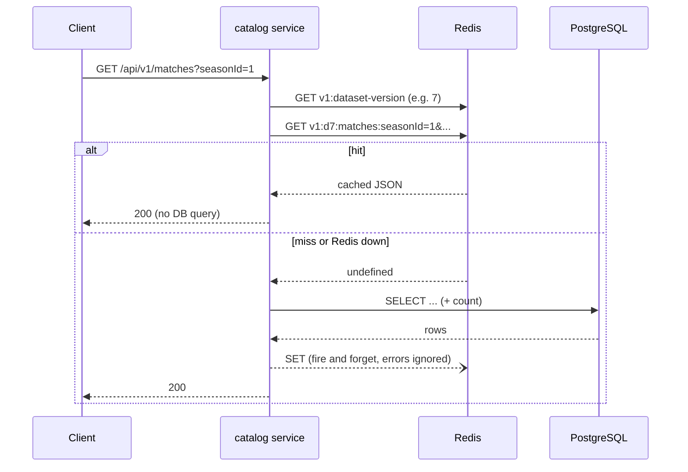

# Caching

Pattern: **cache-aside**, implemented once in `src/shared/cache/cache-aside.ts` and used by every
read operation in `src/modules/catalog/service.ts`. Full rationale in
[ADR-003](adr/ADR-003-redis-cache-aside.md).

## How a request flows



## Keys and TTL

- Key: `v1:d<version>:<resource>:<param>=<value>&...`, params alphabetically sorted so that the same
  filters in any order hit the same entry. Built by `cacheKey()`; `<version>` is the dataset version.
- TTL: `CACHE_TTL_LIST_SECONDS` (default 60s) for list endpoints, `CACHE_TTL_DETAIL_SECONDS` (default
  120s) for single-resource endpoints.

## Invalidation (dataset version)

Implemented in `src/shared/cache/dataset-version.ts`; rationale in
[ADR-005](adr/ADR-005-async-ingestion-and-cache-invalidation.md).

```mermaid
sequenceDiagram
  participant I as Ingestion (POST /ingestion or CLI)
  participant DB as PostgreSQL
  participant R as Redis
  participant S as catalog service
  I->>DB: BEGIN; upserts; COMMIT
  I->>R: INCR v1:dataset-version (7 -> 8)
  S->>R: GET v1:dataset-version = 8
  S->>R: GET v1:d8:teams:... (miss: key never existed)
  S->>DB: fresh SELECT
  Note over R: v1:d7:* keys are never read again and expire by TTL
```

- One `INCR` invalidates the whole catalog, no matter how many keys exist.
- Only runs that commit data (`COMPLETED`, `PARTIAL`) bump the version; `FAILED` and skipped runs don't.
- If the version can't be read, the request skips the cache and reads PostgreSQL directly.

Check it locally: `docker compose exec redis redis-cli get v1:dataset-version` before and after an
ingestion, and `redis-cli --scan --pattern 'v1:d*'` to see keys of both versions.

## Graceful degradation

If Redis is slow, down, or `REDIS_ENABLED=false`, the API keeps working from PostgreSQL alone:

1. `wrapRedis()` catches every Redis call; a failure is logged and treated as a miss / no-op, never thrown.
2. The `ioredis` client has an `on('error', ...)` listener. Without it, an unhandled `error` event on a
   Node `EventEmitter` crashes the process — this is what actually makes "Redis down ≠ API down" true.
3. `/health/ready` reports `{ postgres, redis }` but only a PostgreSQL failure returns `503`.

This is verified by tests, not just asserted: `tests/unit/cache.test.ts` simulates a Redis client whose
every method rejects, and `tests/unit/catalog.test.ts` hits a real endpoint through `buildApp` with a
failing cache and checks it still returns `200` with correct data.

## Known limitations

- If Redis is unreachable at the moment an ingestion finishes, the `INCR` is lost and data can be stale
  until TTL (the TTL remains the safety net).
- Every catalog read does one extra Redis `GET` for the version.
- No cache hit/miss metrics yet (planned for the observability phase).
- Single Redis instance; no cluster/HA configuration (fine for a portfolio project, revisit for production).
